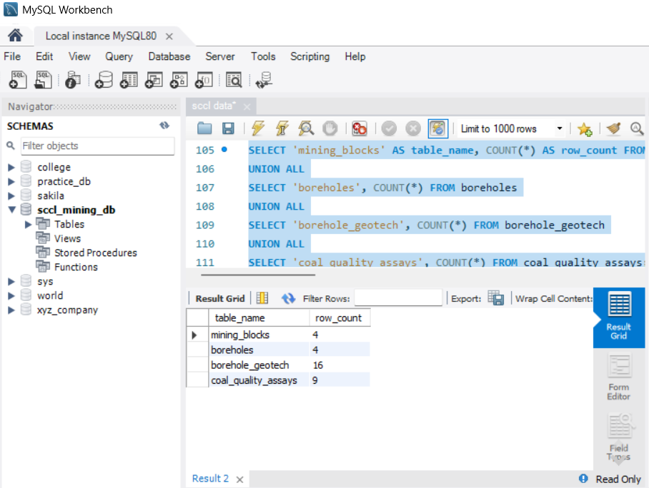
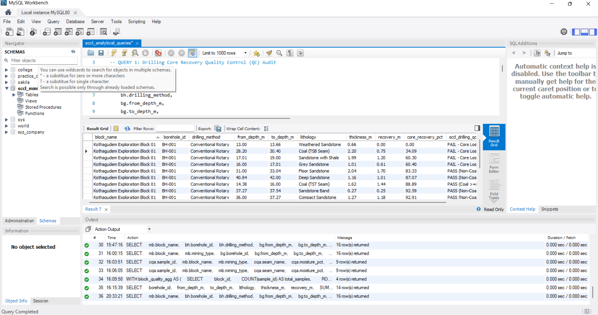
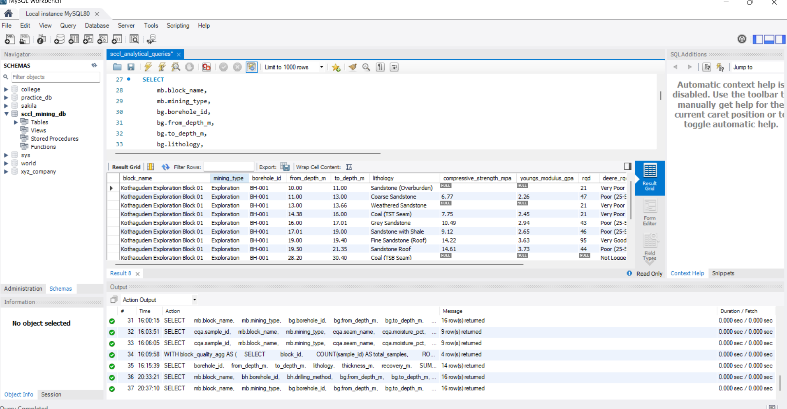
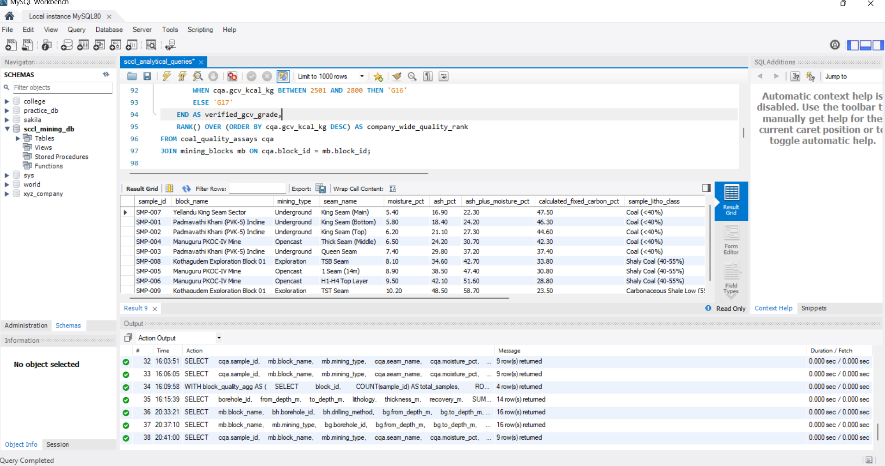
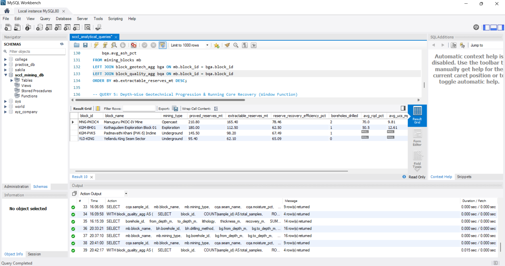
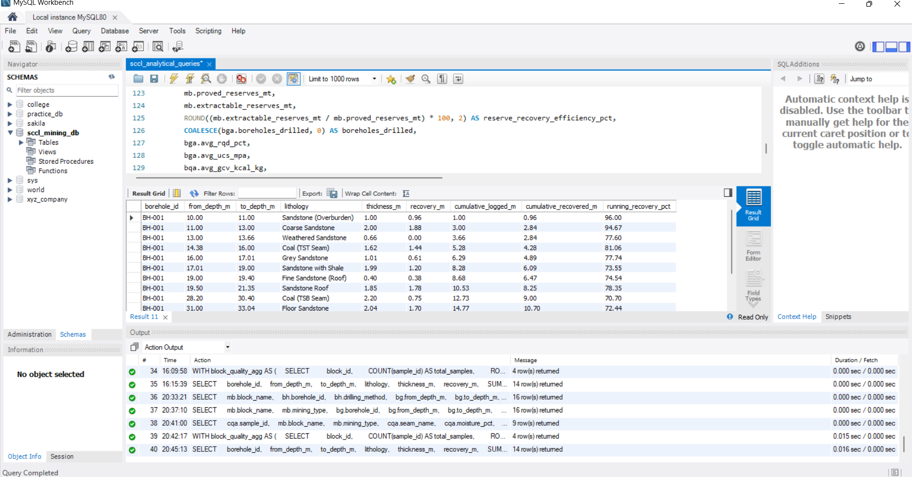

# SCCL-Coal-Exploration-analytics
Surface and Subsurface geotechnical risk screening and coal assay database pipeline using MySQL, Python, and Excel.

## Phase 1: MySQL Database & Analytical Results

### 1. Database Table Row Counts

### 2. Drilling Core Recovery QC Audit (>=85% Coal / >=70% Non-Coal)

### 3. Geotechnical Roof & Strata Stability (RQD Profile)

### 4. Coal Quality & GCV Grade Verification (G1–G17)

### 5. Block-Level Reserve Recoverability & Geotechnical KPIs

### 6. Cumulative Borehole Core Recovery & Depth Progression

